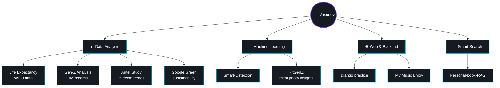

<div align="center">

<!-- Header Banner -->


<!-- Typing SVG -->
[](https://git.io/typing-svg)

<p align="center">
  
  
  
</p>

<p align="center">
  <a href="https://linkedin.com/in/vasudev-talaviya">
    
  </a>
  &nbsp;&nbsp;
  <a href="mailto:vasudevtalaviya23@gmail.com">
    
  </a>
  &nbsp;&nbsp;
  <a href="https://github.com/vasudev-talaviya?tab=repositories">
    
  </a>
</p>

</div>

---

## 🖥️ whoami

```json
{
  "developer": "Vasudev Talaviya",
  "education": "B.C.A. in AI & Data Science",
  "location": "Surat, Gujarat, India 🇮🇳",
  "currently_building": "Personal-book-RAG (semantic search with exact citations)",
  "core_focus": ["Data Analysis", "Applied ML", "Interactive Streamlit Dashboards"],
  "philosophy": "Turning raw data and models into intuitive, living applications"
}
```

---

## 🗂️ My Projects

| | Project | What it is |
|:-:|---|---|
| 📚 | **[Personal-book-RAG](https://github.com/vasudev-talaviya/Personal-book-RAG)** `🆕 Latest` | Ask a question in plain language and get the exact page from my own books and notes. |
| 🔍 | **[Smart-Detection](https://github.com/vasudev-talaviya/Smart-Detection)** | A trained computer vision model designed for object detection. |
| 📊 | **[Gen-Z-analysis](https://github.com/vasudev-talaviya/Gen-Z-analysis)** | A study of 1,000,000+ records to understand the habits and choices of Gen Z. |
| 📶 | **[Airtel-Case-Study](https://github.com/vasudev-talaviya/airtel-case-study)** `💼 Case Study` | Telecommunications analytics evaluating market trends, user growth, and business patterns. |
| 🌱 | **[Green-Initiatives-of-Google](https://github.com/vasudev-talaviya/green-initiatives-of-google)** `🌱 Case Study` | Sustainability analytics analyzing Google's carbon neutrality, clean energy, and green operations. |
| 🍎 | **[FitGenZ](https://github.com/vasudev-talaviya/fitgenz)** | A health platform that turns a photo of your meal into simple, useful health insights. |
| 🌍 | **[Life-expectancy-who](https://github.com/vasudev-talaviya/Life-expectancy-who)** | A study of global health data to see what affects how long people live. |
| 🎵 | **[my_music_enjoy](https://github.com/vasudev-talaviya/my_music_enjoy)** | A personal project built around music and audio exploration. |
| 🌐 | **[Django](https://github.com/vasudev-talaviya/Django)** | My practice space for learning backend architecture and web development. |
| 🔢 | **[Number-System-](https://github.com/vasudev-talaviya/Number-System-)** | A foundational project on how number systems work and convert. |

👉 **[See all 18 repositories on my profile →](https://github.com/vasudev-talaviya?tab=repositories)**

---

## ✨ Featured Work

<div align="center">

<table>
<tr>
<td width="50%" valign="top">

### 📚 [Personal-book-RAG](https://github.com/vasudev-talaviya/Personal-book-RAG)
<kbd>Python</kbd> <kbd>ChromaDB</kbd> <kbd>Transformers</kbd> <kbd>BM25</kbd>

Ask plain-language questions and retrieve exact passages with page-level citations from personal books and notes.

<br/>

<a href="https://github.com/vasudev-talaviya/Personal-book-RAG">
  
</a>

</td>
<td width="50%" valign="top">

### 🔍 [Smart-Detection](https://github.com/vasudev-talaviya/Smart-Detection)
<kbd>Python</kbd> <kbd>Computer Vision</kbd> <kbd>Machine Learning</kbd>

A computer vision project focused on automated detection, image processing, and model classification.

<br/>

<a href="https://github.com/vasudev-talaviya/Smart-Detection">
  
</a>

</td>
</tr>
<tr>
<td width="50%" valign="top">

### 📊 [Gen-Z-analysis](https://github.com/vasudev-talaviya/Gen-Z-analysis)
<kbd>Python</kbd> <kbd>Pandas</kbd> <kbd>NumPy</kbd> <kbd>Streamlit</kbd>

In-depth exploratory data analysis and interactive dashboard examining 1,000,000+ demographic records.

<br/>

<a href="https://github.com/vasudev-talaviya/Gen-Z-analysis">
  
</a>

</td>
<td width="50%" valign="top">

### 🍎 [FitGenZ](https://github.com/vasudev-talaviya/fitgenz)
<kbd>Python</kbd> <kbd>Data Analysis</kbd> <kbd>Health Tech</kbd>

A health platform that transforms food photos and dietary data into actionable wellness insights.

<br/>

<a href="https://github.com/vasudev-talaviya/fitgenz">
  
</a>

</td>
</tr>
<tr>
<td width="50%" valign="top">

### 📶 [Airtel-Case-Study](https://github.com/vasudev-talaviya/airtel-case-study)
<kbd>Business Analytics</kbd> <kbd>Python</kbd> <kbd>Telecom</kbd> <kbd>EDA</kbd>

Telecommunications case study examining telecom subscriber distributions, market penetration, and business metrics.

<br/>

<a href="https://github.com/vasudev-talaviya/airtel-case-study">
  
</a>

</td>
<td width="50%" valign="top">

### 🌱 [Green-Initiatives-of-Google](https://github.com/vasudev-talaviya/green-initiatives-of-google)
<kbd>Sustainability</kbd> <kbd>Data Analytics</kbd> <kbd>Python</kbd> <kbd>Visualization</kbd>

Data-backed case study investigating Google's global sustainability reports, carbon footprint metrics, and green energy investments.

<br/>

<a href="https://github.com/vasudev-talaviya/green-initiatives-of-google">
  
</a>

</td>
</tr>
</table>

</div>

---

## 📚 Personal-book-RAG &nbsp;`🆕 Latest`

> **Ask a question in plain language. Get the exact page from my own books.**

Instead of flipping through hundreds of pages, this project reads my PDF books and notes, understands them, and finds the passages that best answer a question, along with the book and page they came from.


<details>
<summary><b>💡 What makes it special</b></summary>

<br/>

| | |
|---|---|
| 🧩 **Smart splitting** | Books are cut into meaningful pieces, not random chunks, and every piece remembers its book and page. |
| 🤝 **Two kinds of search** | Meaning-based search catches ideas. Keyword search catches exact terms. Together they miss less. |
| 🏆 **Re-ranking** | A second pass reads the question and each result together to put the best answer first. |
| 🔬 **Honest evaluation** | I wrote a deep analysis of the first version's weak points, then a plan to fix them, and an evaluation script to measure the results. |

**Tech Used:** `Python` • `PyMuPDF` • `ChromaDB` • `Sentence Transformers` • `BM25` • `Cross-Encoder`

</details>

👉 **[View on GitHub →](https://github.com/vasudev-talaviya/Personal-book-RAG)**

---

## 🔍 Smart-Detection

> **Computer vision pipeline focused on automated object detection.**

An end-to-end computer vision implementation designed to take image inputs, run model inference, and output bounding boxes with detection classifications.


👉 **[View Source on GitHub →](https://github.com/vasudev-talaviya/Smart-Detection)**

---

## 📊 Gen-Z-analysis

> **One million records. One question: what is Gen Z really like?**

- Studied career choices, mental health patterns, and everyday habits across a dataset of **1,000,000+ people**.
- Cleaned the data, found the patterns, and turned them into clear visuals.
- Packaged everything into an **interactive dashboard** so anyone can explore the data themselves.

**Tech Used:** `Python` • `Pandas` • `NumPy` • `Streamlit` • `Plotly` • `Seaborn`

👉 **[View on GitHub →](https://github.com/vasudev-talaviya/Gen-Z-analysis)**

---

## 🗺️ What I've Explored



---

## 🛠️ Toolbox

<details open>
<summary><b>Click to expand / collapse</b></summary>

<br/>

<div align="center">

#### Programming & Databases


#### Data Analysis & Machine Learning


#### AI Search & Retrieval


#### Visualization & Interactive Apps


#### Everyday Tools


</div>

</details>

---

## 🎧 Vibe Coding Station

<div align="center">


<br/><br/>

> **Dev Reality:**  
> **Q:** Why do programmers prefer dark mode and headphones?  
> **A:** Because light attracts bugs, and noise ruins the vibe. 🎧✨

<br/>

<p align="center">
  <a href="https://linkedin.com/in/vasudev-talaviya">
    
  </a>
  &nbsp;&nbsp;
  <a href="mailto:vasudevtalaviya23@gmail.com?subject=Hey%20Vasudev!">
    
  </a>
  &nbsp;&nbsp;
  <a href="https://github.com/vasudev-talaviya?tab=repositories">
    
  </a>
</p>

<br/>


</div>
